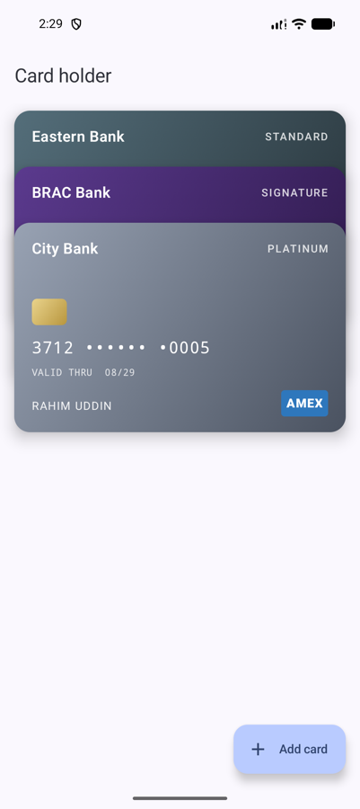
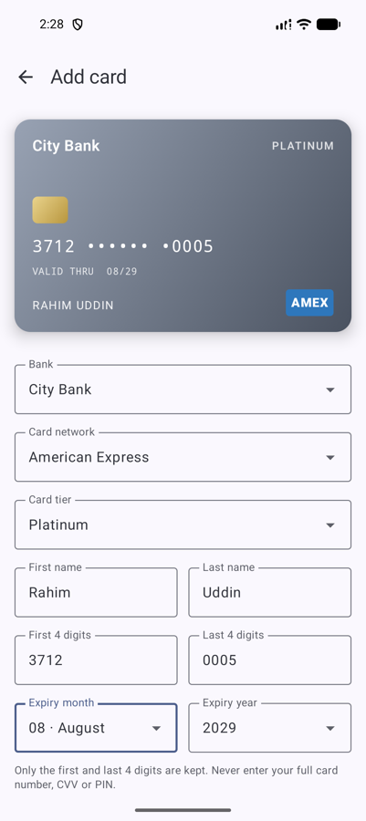
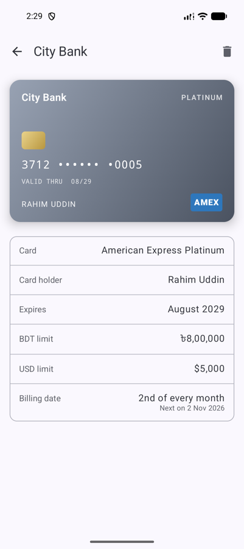

# Card holder

A wallet for your credit cards, in the spirit of Google Wallet. It keeps each card's bank, network, tier, limits, billing date and expiry date in one place, without ever holding the full card number.

The first release covers credit cards issued in **Bangladesh**.

<p align="center">
  
  &nbsp;
  
  &nbsp;
  
</p>

## What it does

- **Wallet.** Your cards are stacked like real cards in a wallet, each colored by its tier. Tap a card to see its details.
- **Card details.** Shows the BDT and USD limits, the expiry date, and the billing date along with the next date the bill is due. BDT amounts are grouped the Bangladeshi way (৳12,00,000).
- **Adding a card.** Choose the bank, then the network, then the tier. Each list offers only what the chosen bank actually issues, so you can't pick a card that doesn't exist. A preview of the card updates as you type.
- **Removing a card.** Use the delete button on the card's page. It asks before removing.

### What you enter

| Field | Notes |
|---|---|
| Bank | Picked from the banks below |
| Card network | Only the networks that bank issues |
| Card tier | Only the tiers that bank issues on that network |
| First and last name | As printed on the card |
| First 4 and last 4 digits | The middle digits are never asked for |
| Expiry month and year | Months that have already passed can't be chosen |
| BDT limit | Required |
| USD limit | Enter 0 if the card has none |
| Billing date | The day of the month the statement is generated |

### How the details are checked

- **The first 4 digits must match the network:** Visa starts with 4, Mastercard with 51–55 or 2221–2720, Amex with 34 or 37, Diners Club with 300–305, 36, 38 or 39, UnionPay with 62, and JCB with 3528–3589.
- **Names** can contain only letters, spaces, dots, hyphens and apostrophes.
- **Changing the bank** clears the network and tier you had chosen if the new bank doesn't offer them.
- **A billing date of 29–31** falls on the last day of shorter months.
- **Errors for empty fields** stay hidden until you tap *Save card*. A wrong value is flagged as soon as you type it.

## Supported banks

21 banks, gathered from each bank's own credit card pages in October 2026.

| Bank | Visa | Mastercard | Amex | Diners Club | UnionPay | JCB |
|---|---|---|---|---|---|---|
| AB Bank | | Gold, Titanium, World | | | | |
| Bank Asia | Gold, Platinum, Signature | Gold, Titanium, World Elite | | | | |
| BRAC Bank | Classic, Gold, Platinum, Signature, Infinite | Classic, Gold, Platinum, Titanium, World | | Emerald | | |
| City Bank | Platinum | World Elite | Blue, Gold, Platinum, Platinum Reserve, Ultramarine | | | |
| Dhaka Bank | Gold, Platinum, Signature | Titanium, World | | | | |
| Dutch-Bangla Bank | Gold, Platinum, Signature | Gold, Titanium, World | | | | |
| Eastern Bank | Classic, Gold, Platinum, Signature, Infinite | Titanium, World, World Elite | | Standard | Platinum | |
| IFIC Bank | Gold, Platinum | | | | | |
| Islami Bank Bangladesh | Gold, Platinum, Signature | Gold, Platinum, World | | | Gold, Platinum | |
| Jamuna Bank | Classic, Gold, Platinum, Signature | | | | | |
| LankaBangla Finance | Classic, Gold, Platinum | Classic, Gold, Titanium | | | | |
| Mercantile Bank | Classic, Gold, Platinum, Signature | Titanium, World | | | | |
| Mutual Trust Bank | Classic, Gold, Platinum, Signature | Classic, Gold, Titanium, World | | | Platinum, Diamond | |
| NCC Bank | Classic, Gold, Platinum, Signature | Titanium | | | | |
| ONE Bank | Classic, Gold, Platinum, Signature | | | | | |
| Prime Bank | Gold, Platinum, Signature | Platinum, World | | | | Gold, Platinum |
| Pubali Bank | Classic, Gold, Platinum | Titanium, World | | | | |
| Southeast Bank | Classic, Gold, Platinum, Signature | Standard, Titanium, World | | | | |
| Standard Chartered | Classic, Gold, Platinum, Signature | Titanium | | | | |
| Trust Bank | Classic, Gold, Platinum, Signature | | | | Platinum | |
| United Commercial Bank | Classic, Gold, Platinum, Signature | Classic, Gold, Platinum, World | | | | |

Notes on the list:

- **Co-branded and Islamic cards** are listed under the tier they are issued on. For example, an EBL Daraz card is a Visa, and a Dhaka Bank Tayyebah card is a Mastercard Titanium.
- **Corporate cards** are not included.
- **HSBC** is not listed, because it closed its retail banking in Bangladesh in 2025–26.
- **Banks change their cards.** If yours is missing, see [Updating the bank list](#updating-the-bank-list).

## Privacy

- **Only the first and last 4 digits** of the card number are kept. The app never asks for the full number, the CVV or the PIN.
- **Cards stay on the phone.** They are saved in the app's private storage and left out of Google cloud backups and device-to-device transfers.
- **No network access.** The app has no internet permission, no accounts and no analytics.

## Roadmap

- **Expiry reminders:** two months and one month before a card expires, for anyone who wants to cancel it rather than let it renew.
- **Annual fee reminders:** shortly before each card's yearly anniversary, so you can close the card or make sure the annual fee is waived.
- **App lock:** sign-in with a PIN or fingerprint.
- **Security:** encrypting the saved cards, and hiding the app's contents from screenshots and the recent apps screen.
- **Editing a saved card.**
- **Banks outside Bangladesh.**

## Building

You need Android Studio (or JDK 17+ and the Android SDK) with API level 37 installed.

```bash
./gradlew assembleDebug
```

To install the debug build on a connected phone or a running emulator:

```bash
./gradlew installDebug
```

To run the unit tests:

```bash
./gradlew testDebugUnitTest
```

The app runs on Android 7.0 (API 24) and up.

## Project layout

Built with Kotlin and Jetpack Compose (Material 3), in a single `app` module.

```
app/src/main/java/com/ahmadabdullah/cardholder/
├── MainActivity.kt           Switches between the wallet, card and add-card screens
├── data/
│   ├── BankCatalog.kt        Banks, the networks each issues, and the tiers on each network
│   ├── Card.kt               A saved card, and its JSON form
│   └── CardStore.kt          Reads and writes cards.json in private storage
└── ui/
    ├── WalletViewModel.kt    Loads, adds and removes cards
    ├── CreditCardView.kt     Draws a card: tier colors, chip, network mark
    ├── Format.kt             Taka grouping, masked numbers, billing and expiry dates
    ├── wallet/               The stacked wallet
    ├── detail/               A card's details, and removing it
    └── addcard/              The add-card form, and CardDraft, which checks what was entered
```

## Updating the bank list

Every bank, network and tier comes from [`BankCatalog.kt`](app/src/main/java/com/ahmadabdullah/cardholder/data/BankCatalog.kt). Each bank has a comment naming the page its cards were taken from.

To add or change a bank:

1. Find its current credit cards on the bank's own website.
2. Add or edit its entry. Keep the list in alphabetical order.
3. If you added a tier that has no color yet, give it one in `tierColors` in `CreditCardView.kt`.
4. Run `./gradlew testDebugUnitTest`. One of the tests checks that every bank lists at least one tier for each network it offers.
